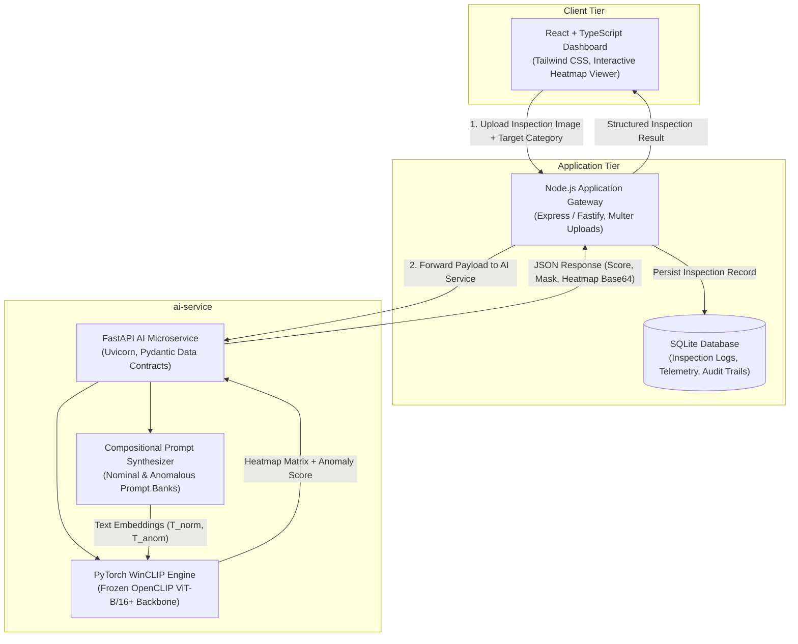

# DefectZero AI — Zero-Shot Industrial Defect Detection

[](./docs/)
[-8A2BE2.svg)](./docs/03_literature_review.md)
[-green.svg)](./experiments/dataset_summary.txt)
[](./ai-service/)
[](./)

> **University Project:** Deep Learning for Computer Vision  
> **Core Objective:** Identify and segment previously unseen industrial surface defects in novel manufacturing categories using pretrained Vision-Language Models (VLMs) without per-category model retraining or nominal memory banks.

---

## 1. Project Overview & Motivation

In automated industrial visual quality inspection, conventional deep learning models face severe deployment bottlenecks:
1. **The Extreme Class Imbalance Dilemma:** Real manufacturing defect rates are typically $<0.1\%$. Collecting thousands of labeled defect examples to train supervised classifiers (YOLO, Mask R-CNN, ResNet) is financially and logistically prohibitive.
2. **The Per-Category Retraining Trap:** State-of-the-art Unsupervised Anomaly Detection (UAD) models like **PatchCore** require hundreds of nominal (defect-free) calibration samples to build a custom memory bank for *every single product variation*.
3. **High-Mix Low-Volume (HMLV) Production:** Fast-changing production lines demand instant inspection capabilities with zero setup time.

**DefectZero AI** solves this by formulating a **Zero-Shot Vision-Language Anomaly Detection** pipeline based on **WinCLIP** (Window-based CLIP). By combining dense multi-scale window attention over Vision Transformer (ViT) patch tokens with compositional text prompt ensembles, DefectZero AI detects and localizes defects on unobserved industrial categories with **zero training images**.

---

## 2. System Architecture

DefectZero AI employs a decoupled, multi-tier architecture isolating high-throughput tensor operations from web application logic:



---

## 3. Directory Layout

```
DefectZero-AI/
│
├── dataset/                        # MVTec Anomaly Detection (15 categories)
│   ├── bottle/                     # Object: 209 train, 83 test (63 defect, 20 good)
│   ├── cable/                      # Object: 224 train, 150 test (92 defect, 58 good)
│   ├── capsule/                    # Object: 219 train, 132 test (109 defect, 23 good)
│   ├── carpet/                     # Texture: 280 train, 117 test (89 defect, 28 good)
│   ├── grid/                       # Texture: 264 train, 78 test (57 defect, 21 good)
│   ├── hazelnut/                   # Object: 391 train, 110 test (70 defect, 40 good)
│   ├── leather/                    # Texture: 245 train, 124 test (92 defect, 32 good)
│   ├── metal_nut/                  # Object: 220 train, 115 test (93 defect, 22 good)
│   ├── pill/                       # Object: 267 train, 167 test (141 defect, 26 good)
│   ├── screw/                      # Object: 320 train, 160 test (119 defect, 41 good)
│   ├── tile/                       # Texture: 230 train, 117 test (84 defect, 33 good)
│   ├── toothbrush/                 # Object: 60 train, 42 test (30 defect, 12 good)
│   ├── transistor/                 # Object: 213 train, 100 test (40 defect, 60 good)
│   ├── wood/                       # Texture: 247 train, 79 test (60 defect, 19 good)
│   └── zipper/                     # Object: 240 train, 151 test (119 defect, 32 good)
│
├── docs/                           # Comprehensive Academic Research Documentation
│   ├── 01_problem_statement.md     # Industrial QA context & task definitions
│   ├── 02_project_objectives.md    # Primary/secondary goals & deliverables
│   ├── 03_literature_review.md     # Classical CV -> UAD -> CLIP -> WinCLIP -> MVTec
│   ├── 04_existing_system_vs_proposed_system.md  # Paradigm comparison & WinCLIP rationale
│   ├── 05_project_scope.md         # Inclusions, explicit exclusions, and user personas
│   ├── 06_proposed_methodology.md  # Mathematical formulations & WinCLIP pipeline
│   └── 07_technology_stack.md      # Full-stack architectural justification
│
├── experiments/                    # Verification & Exploratory Data Analysis
│   ├── verify_dataset.py           # Systematic dataset integrity & mask correspondence audit
│   ├── dataset_summary.txt         # Complete empirical category and mask verification logs
│   ├── eda.py                      # Empirical defect geometry & spatial distribution analysis
│   └── eda_outputs/                # Generated research figures and reports
│       ├── 01_category_distributions.png
│       ├── 02_defect_area_distribution.png
│       ├── 03_defect_size_categories.png
│       ├── 04_spatial_defect_heatmaps.png
│       ├── eda_metrics.json
│       └── eda_report.md
│
├── ai-service/                     # Asynchronous PyTorch / WinCLIP Serving Layer
│   ├── README.md                   # Microservice documentation & API contracts
│   ├── requirements.txt            # Python dependencies (FastAPI, PyTorch, OpenCLIP)
│   └── app/
│       ├── main.py                 # FastAPI application routes
│       ├── config.py               # Runtime settings & supported categories
│       └── schemas.py              # Pydantic request/response models
│
└── README.md                       # Master Project Guide (this file)
```

---

## 4. Dataset Verification & EDA Highlights

The dataset verification (`verify_dataset.py`) and exploratory analysis (`eda.py`) established the following verified empirical baselines:

```
+--------------------------------------------------------------------------------------------------+
|                            MVTec AD Empirical Verification Baselines                             |
+--------------------------------------------------------------------------------------------------+
| Total Categories                  : 15 (5 Textures, 10 Rigid Objects)                           |
| Total Normal Training Images      : 3,629                                                       |
| Total Normal Testing Images       : 467                                                         |
| Total Defective Testing Images    : 1,258                                                       |
| Total Testing Images              : 1,725                                                       |
| Total Inspection Images           : 5,354                                                       |
| Total Ground-Truth Binary Masks   : 1,258 (Exact 1:1 match with defective test images)          |
| Total Unique Defect Classes       : 73 distinct topologies                                      |
| Dataset Integrity Status          : 100% PERFECT MATCH (Zero missing, zero corrupted)          |
+--------------------------------------------------------------------------------------------------+
```

### Key Finding for WinCLIP Modeling
* **39.7% of all defects occupy less than 1.0% of the image area** (median defect area: `1.54%`).
* **Why this matters:** Traditional CLIP processes $224 \times 224$ images split into $16 \times 16$ patches ($14 \times 14$ grid). A micro-defect occupies only 1–2 patch tokens, causing the global `[CLS]` token to completely drown the anomaly signal. Multi-scale sliding window aggregation ($2 \times 2$ and $3 \times 3$ window pooling) is mathematically mandatory to isolate defective tokens.

---

## 5. Technology Stack

| Layer | Technologies Selected | Rationale |
| :--- | :--- | :--- |
| **AI-Assisted Dev** | Google Antigravity | Agentic pair programming, system design & documentation |
| **Deep Learning** | Python, PyTorch, OpenCLIP, WinCLIP | Native CUDA acceleration, Vision Transformer backbones |
| **Experimentation** | Google Colab (T4 / A100 GPU) | High-VRAM environment for high-resolution MVTec evaluation |
| **Dataset** | MVTec AD Benchmark | 15 categories, 5,354 images, pixel-precise ground truth |
| **AI API Microservice** | FastAPI, Uvicorn, Pydantic | Asynchronous REST serving with strict schema contracts |
| **Application Backend** | Node.js, Express / Fastify, Multer | Non-blocking file upload streaming & request orchestration |
| **Database** | SQLite 3 | Zero-configuration relational storage of inspection audit logs |
| **Operator UI** | React, TypeScript, Tailwind CSS | High-contrast industrial dashboard with real-time heatmap controls |

---

## 6. How to Run Verification & EDA

### 6.1 Verify Dataset Integrity
```bash
python experiments/verify_dataset.py
```
*Outputs detailed ASCII tables and saves the report to `experiments/dataset_summary.txt`.*

### 6.2 Run Exploratory Data Analysis (EDA)
```bash
python experiments/eda.py
```
*Processes all 1,258 ground truth masks, computes defect area metrics, plots 4 publication-quality figures, and generates `experiments/eda_outputs/eda_report.md`.*

---

## 7. Foundational References

1. **Bergmann, P. et al. (CVPR 2019):** *MVTec AD — A Comprehensive Real-World Dataset for Unsupervised Anomaly Detection.*
2. **Radford, A. et al. (ICML 2021):** *Learning Transferable Visual Models From Natural Language Supervision (CLIP).*
3. **Roth, K. et al. (CVPR 2022):** *Towards Total Recall in Industrial Anomaly Detection (PatchCore).*
4. **Jeong, J. et al. (CVPR 2023):** *WinCLIP: Zero-/Few-Shot Anomaly Classification and Segmentation.*
5. **Zhou, Q. et al. (ICLR 2024):** *AnomalyCLIP: Being Categorical and Prompt-driven for Anomaly Detection.*
