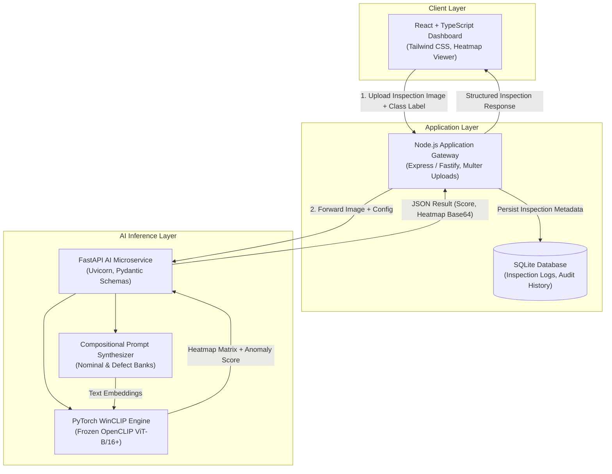

# DefectZero AI — Proposed Methodology & System Architecture

**Project Title:** DefectZero AI — Zero-Shot Industrial Defect Detection  
**Course Context:** Deep Learning for Computer Vision  
**Document Purpose:** Mathematical Formulation, Algorithmic Pipeline & System Architecture  

---

## 1. Algorithmic Overview & Mathematical Formulation

The proposed methodology builds upon the **WinCLIP** (Window-based CLIP) paradigm introduced by Jeong et al. (CVPR 2023). It enables zero-shot anomaly classification and pixel-level localization by aligning dense visual representations extracted across multi-scale spatial windows with compositional text prompt ensembles.

```
                                 [Input Test Image I]
                                          |
                                          v
                              +------------------------+
                              | Vision Transformer     |
                              | Backbone (ViT-B/16+)   |
                              +------------------------+
                                          |
                                          v
                              +------------------------+
                              | Dense Patch Tokens     |
                              | P in R^{H_p x W_p x D} |
                              +------------------------+
                                          |
                    +---------------------+---------------------+
                    |                                           |
                    v                                           v
        +------------------------+                  +------------------------+
        | Global Class Token     |                  | Multi-Scale Sliding    |
        | [CLS] in R^D           |                  | Windows (k x k)        |
        +------------------------+                  +------------------------+
                    |                                           |
                    |                                           v
                    |                               +------------------------+
                    |                               | Window Embeddings      |
                    |                               | W_k in R^{N_w x D}     |
                    |                               +------------------------+
                    |                                           |
                    \                                           /
                     \                                         /
                      v                                       v
         +-----------------------------------------------------------------+
         |             Cross-Modal Text Alignment Engine                   |
         |  Text Embeddings: T_norm (Nominal)  vs.  T_anom (Anomalous)     |
         +-----------------------------------------------------------------+
                    |                                           |
                    v                                           v
        +------------------------+                  +------------------------+
        | Image Anomaly Score    |                  | Pixel Anomaly Heatmap  |
        | s_image in [0, 1]      |                  | M(x, y) in [0, 1]      |
        +------------------------+                  +------------------------+
```

---

## 2. Mathematical Formulation of the WinCLIP Pipeline

### 2.1 Visual Feature Extraction & Multi-Scale Windowing
Let $I \in \mathbb{R}^{H \times W \times 3}$ denote an input inspection image. The image is passed through a frozen Vision Transformer (ViT) visual encoder $f_v$.
* The ViT partitions the image into non-overlapping spatial patches of size $P \times P$ (e.g., $16 \times 16$), yielding a grid of spatial patch tokens:

$$\mathbf{F}_{patch} \in \mathbb{R}^{H_p \times W_p \times D}, \quad H_p = \frac{H}{P}, \quad W_p = \frac{W}{P}$$

along with a global classification token $\mathbf{f}_{cls} \in \mathbb{R}^D$.
* Rather than relying solely on $\mathbf{f}_{cls}$, which discards spatial locality, WinCLIP defines spatial windows of multiple kernel sizes $K \in \{k_1, k_2, \dots, k_M\}$ (e.g., $2 \times 2, 3 \times 3$).
* For each window scale $k$, a sliding window aggregates local patch tokens via spatial pooling (average or attention pooling), producing window embeddings:

$$\mathbf{w}_{i, j}^{(k)} = \text{Pool}\left(\left\{\mathbf{F}_{patch}[u, v] \mid u \in [i, i+k), v \in [j, j+k)\right\}\right) \in \mathbb{R}^D$$

### 2.2 Compositional Text Prompt Synthesis
For a given object category $c$ (e.g., `"metal nut"`, `"leather"`, `"bottle"`), we synthesize two distinct text prompt banks:

1. **Nominal Prompt Ensemble ($\mathcal{T}_{norm}$):**
   A set of $N_{norm}$ state descriptions denoting flawless quality:
   $$\mathcal{T}_{norm} = \left\{\text{"a photo of a flawless [c]"}, \text{"a clean [c]"}, \text{"an undamaged [c]"}, \dots\right\}$$
   Each prompt $t_m \in \mathcal{T}_{norm}$ is encoded by the frozen text encoder $f_t$, producing normalized nominal text embeddings:
   $$\bar{\mathbf{t}}_{norm} = \frac{1}{|\mathcal{T}_{norm}|} \sum_{t \in \mathcal{T}_{norm}} \frac{f_t(t)}{\|f_t(t)\|}$$

2. **Anomalous Prompt Ensemble ($\mathcal{T}_{anom}$):**
   A set of $N_{anom}$ descriptions covering generic defect states and specific industrial defect topologies:
   $$\mathcal{T}_{anom} = \left\{\text{"a photo of a damaged [c]"}, \text{"a defective [c]"}, \text{"a [c] with a scratch"}, \text{"a [c] with a crack"}, \dots\right\}$$
   Producing an aggregated normalized anomalous text embedding:
   $$\bar{\mathbf{t}}_{anom} = \frac{1}{|\mathcal{T}_{anom}|} \sum_{t \in \mathcal{T}_{anom}} \frac{f_t(t)}{\|f_t(t)\|}$$

### 2.3 Dense Anomaly Localization Map Generation
For every window embedding $\mathbf{w}_{i, j}^{(k)}$, the anomaly score is computed as the softmax-normalized probability of alignment with the anomalous text subspace:

$$S_{win}^{(k)}(i, j) = \frac{\exp\left(\langle \mathbf{w}_{i, j}^{(k)}, \bar{\mathbf{t}}_{anom} \rangle / \tau\right)}{\exp\left(\langle \mathbf{w}_{i, j}^{(k)}, \bar{\mathbf{t}}_{anom} \rangle / \tau\right) + \exp\left(\langle \mathbf{w}_{i, j}^{(k)}, \bar{\mathbf{t}}_{norm} \rangle / \tau\right)}$$

where $\tau$ is the softmax temperature parameter.
* The window anomaly maps across all scales $k \in K$ are bilinearly upsampled to the original image dimensions $H \times W$ and averaged:

$$\mathcal{M}_{zero}(x, y) = \frac{1}{|K|} \sum_{k \in K} \text{BilinearUpsample}\left(S_{win}^{(k)}\right)(x, y)$$

* A 2D Gaussian filter kernel $G_\sigma$ is applied to smooth interpolation artifacts:

$$\mathcal{M}_{final} = G_\sigma * \mathcal{M}_{zero}$$

### 2.4 Image-Level Anomaly Score Derivation
The global image anomaly score $s_{image} \in [0, 1]$ combines the global `[CLS]` token alignment score with the peak spatial defect intensity:

$$s_{cls} = \frac{\exp\left(\langle \mathbf{f}_{cls}, \bar{\mathbf{t}}_{anom} \rangle / \tau\right)}{\exp\left(\langle \mathbf{f}_{cls}, \bar{\mathbf{t}}_{anom} \rangle / \tau\right) + \exp\left(\langle \mathbf{f}_{cls}, \bar{\mathbf{t}}_{norm} \rangle / \tau\right)}$$

$$s_{image} = \alpha \cdot s_{cls} + (1 - \alpha) \cdot \max_{(x, y)} \mathcal{M}_{final}(x, y)$$

where $\alpha \in [0, 1]$ is a balancing hyperparameter.

### 2.5 Few-Shot Visual Reference Adaptation (WinCLIP+)
When $k$ nominal reference images $\mathcal{R} = \{R_1, \dots, R_k\}$ are available:
* Reference patch embeddings are extracted and stored.
* For each test patch embedding $p$, a visual distance score $d_{vis}(p)$ is computed as the Euclidean distance to the nearest nominal reference patch:

$$d_{vis}(p) = \min_{r \in \mathcal{R}} \|p - r\|_2$$

* The zero-shot score $\mathcal{M}_{zero}$ and visual score $\mathcal{M}_{vis}$ are fused via their **harmonic mean**:

$$\mathcal{M}_{few}(x, y) = \frac{2 \cdot \mathcal{M}_{zero}(x, y) \cdot \mathcal{M}_{vis}(x, y)}{\mathcal{M}_{zero}(x, y) + \mathcal{M}_{vis}(x, y) + \epsilon}$$

---

## 3. Step-by-Step System Execution Pipeline

```
[1. Ingestion]       --> Image upload (RGB format, min 224x224, normalized to CLIP stats)
[2. Prompting]       --> Generate T_norm & T_anom for target object class c
[3. Extraction]      --> Forward pass through ViT; extract [CLS] & patch tokens
[4. Window Pooling]  --> Aggregate multi-scale spatial tokens (2x2, 3x3)
[5. Similarity Calc] --> Cosine dot product with text embeddings + Softmax
[6. Map Upsampling]  --> Bilinear interpolation to H x W + Gaussian smoothing
[7. Post-Processing] --> Global score computation + Dynamic threshold binary masking
[8. Serving API]     --> Return JSON payload: { score, decision, heatmap_url, mask_url }
```

---

## 4. End-to-End System Architecture

DefectZero AI is designed as a decoupled, multi-tier system separating high-compute PyTorch inference from application routing and the user dashboard:



### Component Responsibilities:
1. **Frontend Dashboard (React, TypeScript, Tailwind CSS):**
   * High-contrast industrial UI.
   * Image upload zone with drag-and-drop.
   * Dual-view canvas: Original Image side-by-side with Anomaly Heatmap.
   * Adjustable sensitivity slider ($\tau_{thresh}$) for real-time binary mask re-thresholding.
2. **Application Backend (Node.js):**
   * Authenticates requests, validates file uploads, and handles storage of raw and annotated images.
   * Manages SQLite queries for inspection session histories, telemetry, and reporting.
3. **AI Inference Microservice (FastAPI / Python):**
   * Encapsulates the PyTorch and OpenCLIP runtime.
   * Loads model weights once during startup into GPU VRAM.
   * Executes batch or single-image WinCLIP inference asynchronously.
4. **Relational Database (SQLite):**
   * Stores inspection logs: `id`, `timestamp`, `category`, `image_path`, `anomaly_score`, `is_defective`, `operator_notes`.

---

## 5. Evaluation Protocol & Metric Definitions

To ensure academic rigor, DefectZero AI will be benchmarked on the 15 categories of the MVTec AD dataset using three formal evaluation metrics:

```
+---------------------------------------------------------------------------------------------------+
|                                     Evaluation Metrics Suite                                      |
+---------------------------------------------------------------------------------------------------+
| 1. Image-Level AUROC                                                                              |
|    Measures whole-image classification capability (nominal vs. defective) across all thresholds. |
+---------------------------------------------------------------------------------------------------+
| 2. Pixel-Level AUROC                                                                              |
|    Measures dense localization accuracy by treating every individual pixel as a binary test.      |
+---------------------------------------------------------------------------------------------------+
| 3. Per-Region Overlap (PRO)                                                                       |
|    Evaluates overlap on each connected defect component up to 30% False Positive Rate (FPR <= 0.3)|
|    Treats small micro-defects equally with large structural abrasions.                            |
+---------------------------------------------------------------------------------------------------+
```

### Mathematical Definitions:
* **AUROC:** Computed as the integral of the True Positive Rate ($\text{TPR}$) against False Positive Rate ($\text{FPR}$) across varying threshold criteria:

$$\text{AUROC} = \int_{0}^{1} \text{TPR}(\text{FPR}^{-1}(u)) \, du$$

* **PRO Metric:** For a connected ground truth anomaly region $R_k$ and a binary prediction map $P_\tau$ thresholded at $\tau$:

$$\text{PRO}(\tau) = \frac{1}{K} \sum_{k=1}^K \frac{|P_\tau \cap R_k|}{|R_k|}$$

The PRO score is the normalized area under the $\text{PRO}(\tau)$ curve plotted against $\text{FPR} \in [0, 0.3]$.

---

## 6. Pre-Implementation Status Declaration

> [!NOTE]
> The architectural components, mathematical pipelines, and metric frameworks described above represent the theoretical and engineering design for DefectZero AI. Implementation, code authoring, and empirical experiments will be executed in subsequent development stages.
